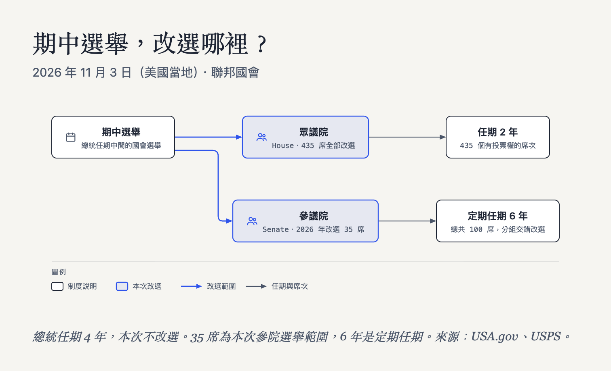

美國期中選舉（Midterm Elections），是**兩次總統選舉之間的國會選舉**。2026 年的選舉日在**美國當地 11 月 3 日，星期二**。這次不改選總統，但選民會改選全部 435 個眾議院投票席次，以及 35 個參議院席次；同年也有 36 州選州長。[USA.gov 國會選舉說明](https://www.usa.gov/midterm-elections)、[USPS 2026 選舉資訊](https://about.usps.com/postal-bulletin/2026/pb22712/html/cover_003.htm)

對台灣讀者來說，可以先這樣理解：**總統任期還沒結束，選民先重新決定國會裡由哪些人代表自己。** 總統繼續任職，推動法律、預算及部分人事案時，面對的國會組成卻可能改變。

> **想直接看開票資訊？** 前往 [TWTools「2026 美國期中選舉開票」中文頁](https://twtools.cc/elections/us/2026-midterm/)。該頁追蹤聯邦參議員與州長選舉，並整理台北時間的關票資訊；目前不提供 435 個眾議院選區的即時票數。票數由第三方 civicAPI 彙整，屬非官方資訊，最終以各州認證結果為準。

本文與圖解依文末〈來源〉整理，查核日期為 **2026 年 11 月 1 日，台北時間**。這是一篇制度入門，不包含民調、勝選預測或即時政黨席次。

## 一、為什麼叫「期中」？是在替總統打分數嗎？

美國總統每 4 年選一次，國會選舉每 2 年就舉行一次。因此，國會選舉有時和總統選舉同年，有時落在兩次總統選舉之間；後者就是「期中選舉」。下次美國總統選舉是 2028 年。[USA.gov 期中選舉說明](https://www.usa.gov/midterm-elections)、[總統選舉流程](https://www.usa.gov/presidential-election-process)

「總統的期中考」是容易理解的比喻，但選票上實際選的是國會議員等職位，**不是勾選「要不要讓總統繼續做」**。即使總統所屬政黨失去國會多數，也不會因此自動重新選總統。

換成台灣讀者熟悉的情境：你可以支持某位總統，同時希望由不同政黨的民意代表審查法案與預算。總統與國會是不同職位，選舉結果需要分開看。不過，美國有參、眾兩院，不能把它完整套成台灣的總統與立法院關係。

## 二、2026 到底選什麼？先分清楚參議院和眾議院

美國國會（Congress）分成**眾議院**（House of Representatives）和**參議院**（Senate）。兩院同屬聯邦立法部門，並不是「中央議會」和「地方議會」的差別。[USA.gov 國會組成](https://www.usa.gov/midterm-elections)

| 項目 | 眾議院 | 參議院 |
|---|---|---|
| 全院規模 | 435 個有投票權的席次 | 100 席 |
| 代表方式 | 各州依人口分配席次，議員代表特定國會選區 | 每州 2 席 |
| 定期任期 | 2 年 | 6 年 |
| 改選方式 | 每 2 年全部改選 | 每 2 年交錯改選約三分之一 |
| 2026 年選舉範圍 | 全部 435 席 | 35 席 |

表格依 [USA.gov](https://www.usa.gov/midterm-elections)、[眾議院制度說明](https://www.house.gov/the-house-explained)及 [USPS 本次選舉資訊](https://about.usps.com/postal-bulletin/2026/pb22712/html/cover_003.htm)整理。「435 席」指有全院表決權的席次；華府與部分領地另有代表，不能把 435 當成所有國會成員的總數。任期欄是定期任期，不能據此認為補缺選舉都會另開一個完整任期。

可以記成兩句：**眾議院看人口，每 2 年全部重選；參議院每州一樣有 2 席，分批改選。** 所以，這次沒有參議員選舉的州，不代表漏辦選舉，而是可能還沒輪到該州的席位。[USA.gov 參議員選舉說明](https://www.usa.gov/midterm-elections)

### 參、眾兩院平常做什麼？怎麼分工？

**訂法律、決定政府經費，通常要兩院合作。** 一般聯邦法案可以由參議員或眾議員提出，兩院各自審查、修改與表決；最後必須通過相同版本，才送交總統簽署或否決。政府經費的撥款法案，也要經過兩院同意。[USA.gov 立法流程](https://www.usa.gov/how-laws-are-made)、[聯邦預算流程](https://www.usa.gov/federal-budget-process)

**監督政府，也是兩院都有的工作。** 兩院都能透過委員會舉行聽證、要求官員說明政策或調查施政問題。[白宮的國會職權說明](https://www.whitehouse.gov/government/legislative-branch/)

另外，有幾項工作由憲法分別交給其中一院：

| 工作 | 眾議院負責什麼？ | 參議院負責什麼？ |
|---|---|---|
| 稅收等歲入法案 | 法案須先從眾院提出 | 可以審議、提出修正，最後仍須兩院同意 |
| 部長、聯邦法官等人事案 | 不參與這類提名的同意表決 | 審查依法須經參院同意的總統提名 |
| 條約同意 | 不負責這項同意表決 | 決定是否同意批准條約 |
| 彈劾聯邦官員 | 表決是否正式提出彈劾指控 | 進行彈劾審判，決定指控是否成立 |

表格依[眾院的歲入權說明](https://history.house.gov/Institution/Origins-Development/Power-of-the-Purse/Power-of-the-Purse/)、[白宮的立法部門介紹](https://www.whitehouse.gov/government/legislative-branch/)、[參院的條約同意權說明](https://www.senate.gov/about/powers-procedures/treaties.htm)及 [USA.gov 彈劾流程](https://www.usa.gov/impeachment)整理。人事案這裡指依法須經參院同意的職位，不能擴大解讀成所有任命；條約也有特定的憲法程序，各種對外協議不一定都走同一套。**眾院通過彈劾，是提出指控；仍須經參院審判，並不會在眾院表決後立即解職。**

舉例來說，總統提名最高法院大法官時，要看參議院是否同意；若要通過一筆政府經費的撥款法案，就要看參、眾兩院能否通過同一版本。從這樣的分工來看，選舉後即使同一政黨只拿下一院多數，也可能影響不同的政策與人事決定。

### 為什麼這次參議院名單沒有加州？

加州（California）也是每州 2 席，但 **2026 年沒有聯邦參議員席位改選**。加州州務卿公布的本次正式候選人名單，列有州長、聯邦眾議員等職位，沒有「United States Senator」這個職位。因此，在開票頁的參議員分頁找不到加州，是本次改選範圍的差異，不是加州沒有參議員。[加州 2026 年大選官方候選人名單（PDF）](https://elections.cdn.sos.ca.gov/statewide-elections/2026-general/cert-list-candidates.pdf)

還要注意，名單中的「State Senator」指**州議會參議員**，與華府聯邦國會的「United States Senator」不同。加州今年仍有州長、聯邦眾議員等選舉；看名單時，要先確認選的是哪一層級、哪一個職位。

<figure id="us-midterm-diagram" style="margin:2rem 0;padding:1rem;border:1px solid var(--tw-border);border-radius:12px;background:var(--tw-bg-secondary,transparent);">

<figcaption style="font-size:0.875rem;line-height:1.7;margin-top:0.75rem;">箭頭表示改選範圍及任期說明，並非選情走勢。手機顯示動畫；不支援播放、偏好減少動態或未啟用 JavaScript 時顯示靜態圖。<a href="/blog/us-midterm-elections-guide-2026/cycle.html" target="_blank" rel="noopener">開啟互動圖解</a>，可使用全螢幕功能。圖解使用 <a href="https://github.com/Aryanutkarsh/seecode" target="_blank" rel="noopener">SeeCode</a>（Aryanutkarsh，MIT 授權），授權全文保留於互動圖檔。</figcaption>
</figure>

另外，期中選舉年也會有地方選舉。USPS 列出 2026 年有 **36 州選州長（Governor）**，以及許多州、地方層級的選舉。因此，每個人的選票內容不一定相同；看到州長新聞，也別把州長席次加進國會席次。[USPS 選舉資訊](https://about.usps.com/postal-bulletin/2026/pb22712/html/cover_003.htm)

## 三、跟台灣差在哪？九合一不是同一種選舉

最容易混淆的是：台灣 2026 年也有大型選舉，但 **11 月 28 日九合一改選的是地方公職，不是立法委員**。中選會的程序表列有縣市長、縣市議員，以及鄉鎮市長、民意代表、村里長等地方職位。[中選會 2026 選舉專區](https://info.cec.gov.tw/vote2026/)、[地方選舉工作程序](https://web.cec.gov.tw/central/article/61722)

因此，要比較國會制度，應拿美國國會對照台灣立法院；要比較地方首長，才拿美國州長對照台灣縣市長。這裡只是協助理解職位層級，並不表示兩者權限完全相同。

| 比較項目 | 美國 | 台灣 |
|---|---|---|
| 中央立法機關 | 參議院、眾議院，分成兩院 | 單一立法院，113 席立委 |
| 國會定期任期 | 眾議員 2 年，參議員 6 年 | 立委 4 年 |
| 定期改選節奏 | 眾院全部改選，參院分批改選 | 立委定期屆滿改選，沒有參院式的分組輪替 |
| 席次如何組成 | 眾院依人口分配；參院每州 2 席 | 73 席區域、6 席原住民、34 席不分區及僑居國外國民 |
| 政黨票怎麼看 | 國會席次來自各選區、各州選出的議員 | 部分立委席次依政黨票分配 |
| 2026 年這場大型選舉 | 11 月 3 日期中選舉，包含國會改選 | 11 月 28 日九合一地方選舉，不改選立委 |

比較依 [USA.gov](https://www.usa.gov/midterm-elections)、[眾議院](https://www.house.gov/the-house-explained)、[《中華民國憲法增修條文》第 4 條](https://www.president.gov.tw/Page/95)及上述中選會公告整理。表中的任期與改選節奏指一般定期情況，不涵蓋補選或立法院解散後改選等例外。

有兩個差別特別值得記住。

**第一，美國國會要分開看兩院。** 台灣新聞常說「立法院哪個黨比較多席」；看美國選舉時，還得再問一次：「說的是眾議院，還是參議院？」一個政黨可能在其中一院占多數，另一院卻不是。

**第二，不要把全國得票率直接當成國會席次比例。** 台灣立委有一部分席次來自政黨票；美國參、眾兩院這裡算的則是各州、各選區選出的席次。依這些制度差異推論，只看全國加總票數，無法直接知道哪個政黨取得哪一院多數。

## 四、不換總統，為什麼還這麼重要？

因為總統推動政策，不是自己宣布就能把所有事情變成法律。一般聯邦法案須經參、眾兩院通過相同版本，再送總統簽署；總統也可以否決。這就是國會組成會影響施政的重要原因。[USA.gov 立法流程](https://www.usa.gov/how-laws-are-made)

可以從三件事理解國會的影響：

- **法律：** 誰支持、誰反對一項法案，會影響它能否取得兩院同意。
- **預算：** 國會握有審議政府支出的權力，會影響政府的資金安排。
- **人事與監督：** 部分重要行政官員及聯邦法官的總統提名，需要參議院同意；國會也能透過委員會等方式監督行政部門。

這些權限見[白宮的立法部門介紹](https://www.whitehouse.gov/government/legislative-branch/)。據此可以理解，若總統與某一院多數議員對政策看法不同，推動議案便需要爭取更多跨黨支持。

但「拿到多數」不等於「所有事都能自己決定」。兩院可能意見不同，總統可以否決，某些事項也有較高表決門檻。例如，推翻一般總統否決，須兩院各取得三分之二支持。**看國會多數，是看政策推動與制衡條件，不是找出一個能包辦所有決定的政黨。**

## 五、台灣幾點看？開票數字怎麼讀？

先分清楚日期：新聞寫的「11 月 3 日選舉日」是**美國當地日期**。換算到台灣，要看原本使用哪個時區，不能直接把美國日期當成台北日期。

2026 年美國夏令時間在 11 月 1 日結束。以美東標準時間（EST，UTC−5）為例，台北（UTC+8）快 13 小時，所以 **美東 11 月 3 日晚上 6 點，等於台北 11 月 4 日上午 7 點**。這只是時差換算，不是全美統一關票時間，也不保證那時已經有某場選舉的結果。[NIST 夏令時間規則](https://www.nist.gov/pml/time-and-frequency-division/popular-links/daylight-saving-time-dst)、[美國官方時間與時區](https://nist.time.gov/)

例如，肯塔基州（Kentucky）公告在當地下午 6 點結束投票，但該州跨美東與美中時區，不能當成全州都在同一個台北時間關票。美國各地分波結束投票，西岸、夏威夷與阿拉斯加還有較後面的時段；**關票時間軸不是票數必定公布的時間表。** [肯塔基州選舉日說明](https://elect.ky.gov/Frequently-Asked-Questions/Pages/Election-Day-Information.aspx)、[州官方時區說明](https://www.kentuckytourism.com/trip-planning/travel-tools/transportation)

想按台北時間看關票安排，可以開啟 [TWTools 美國期中選舉開票頁](https://twtools.cc/elections/us/2026-midterm/)，時間軸從 **11 月 4 日上午 7 點**的第一波開始。目前即時追蹤的範圍是聯邦參議員與州長；如果你要找某個眾議院選區，不要把該頁沒有列出解讀成「那裡沒有選舉」。

開票時，再分清楚這三種訊息：

| 畫面上的訊息 | 應該怎麼理解 |
|---|---|
| 目前票數、暫時領先 | 已公布票數的當下狀態，後續仍可能變動 |
| 媒體判定勝選（Call／Projected Winner） | 媒體作出的勝負判定，不等於選務機關完成認證 |
| 正式認證結果（Certified Results） | 選務機關完成相關核對程序後確認的結果 |

美國選舉協助委員會（EAC）特別提醒：**即使畫面寫「100% Precincts Reporting」，也不能直接當成結果已正式認證。** 各州對郵寄、暫定及軍人海外選票等有不同計算規則；開票夜之後仍有核對與認證程序，時間也因地而異。[EAC 結果與認證說明](https://www.eac.gov/election-officials/election-results-canvass-and-certification)、[票數為何會在開票夜後改變](https://www.eac.gov/why-do-election-results-change-after-election-night)

所以，閱讀更新時可以依序確認：**這是哪一場選舉？資料更新到何時？是第三方彙整、官方暫時票數，還是已認證結果？** 單一候選人暫時領先、某個州先開完，都不足以直接代表全國國會的最終組成。

## 六、有些州的規則，為什麼和其他州不同？

不要把所有州都想成「當晚票最多的人立即當選」。除了計票與認證需要時間，有些選舉還有額外的勝負規則。

### 喬治亞州：沒有人過半，可能還要再投一次

喬治亞州（Georgia）的這次一般選舉，若某場選舉沒有候選人取得過半票數，前兩名就要進入決選（Runoff）。今年預定的決選日是**美國當地 12 月 1 日**，不是 11 月 3 日當晚再多算一輪，而是另辦一次投票。[喬治亞州政府決選說明](https://georgia.gov/events/2026-12-01/election-day-general-election-runoff)

所以，「第一名」和「已達當選門檻」是兩件事。是否需要決選，得看這一場的票數及適用規則。

### 阿拉斯加：先看第一順位，再看是否需要排序計票

阿拉斯加（Alaska）這次的聯邦參議員、州長等公職選舉，採排序選擇投票（Ranked Choice Voting，RCV）。選民可依喜好替候選人排順位；先計算第一順位票，若無人取得所需多數，再按規則淘汰末位候選人，將其選票轉計給選票上仍在競爭的下一順位候選人。這是使用**同一批選票繼續計算**，不是像喬治亞州那樣再辦一次投票。[阿拉斯加選務機關 RCV 說明](https://www.elections.alaska.gov/election-information/)

開票夜仍可能先看到第一順位票數。官方目前列出的後續排序計票時間，是選舉日後第 15 天，也就是**美國當地 11 月 18 日**，待合格選票審查與計算後進行；如果第一輪已有人取得多數，也不是每場都必須走完後續排序輪次。[阿拉斯加選務機關結果說明](https://www.elections.alaska.gov/election-results/)

看頁面時，遇到還在計票、等待決選或等待排序結果，先確認當地規則與資料狀態。不能只因為某州比別州晚，就推論系統故障或選舉出了問題。

讀完制度，想看各場資訊，可以前往 [2026 美國期中選舉開票頁](https://twtools.cc/elections/us/2026-midterm/)；若也要準備台灣 11 月 28 日投票，可接著看[九合一投票懶人包](/blog/taiwan-local-elections-voting-guide-2026/)。

## 常見問題（FAQ）

### 美國期中選舉會重新選總統嗎？

不會。期中選舉位於兩次總統選舉之間，核心是改選國會議員；同年也有州及地方選舉。2026 年這次不改選總統，下次總統選舉在 2028 年。

### 參議院和眾議院，哪一個比較像台灣立法院？

兩者合在一起，才是美國國會。用中央立法機關的層級理解，應拿整個美國國會對照台灣立法院；兩院各自的任期、代表方式及部分權限不同，不能把其中一院直接當成完全相同的台灣機關。

### 台灣九合一選舉就是美國期中選舉嗎？

不是同一種制度。台灣九合一改選縣市長、議員等地方公職，不改選立委；美國期中選舉的重要部分則是聯邦國會改選，同年也有州及地方選舉。比較時要先看職位層級，不能只看都發生在總統任期中間。

### 為什麼參議院有 100 席，2026 年只選 35 席？

參議員的定期任期是 6 年，席位分組交錯改選，每 2 年約改選三分之一，並不是 100 席同時重選。本次官方選舉資訊列出的範圍為 35 席；6 年指通常定期任期，不代表所有補缺選舉都重新取得完整 6 年。

### TWTools 美國開票頁會提供全部國會選區嗎？

目前即時追蹤聯邦參議員與州長選舉，不提供全部 435 個眾議院選區的即時票數。第三方彙整數字與各州正式認證結果也要分開看。請以該頁當下標示的範圍、來源及更新狀態為準。

## 來源

本文及制度圖只依下列來源整理。官方制度資料與 TWTools 站內功能說明分開使用；TWTools 開票頁不作為選舉勝負或制度的官方依據。

1. [USPS：Key Elections，2026 年選舉日期與改選範圍](https://about.usps.com/postal-bulletin/2026/pb22712/html/cover_003.htm)。
2. [USA.gov：Congressional elections and midterm elections](https://www.usa.gov/midterm-elections)。期中選舉定義、兩院規模與任期。
3. [USA.gov：Overview of the presidential election process](https://www.usa.gov/presidential-election-process)。總統選舉週期及下次選舉年份。
4. [美國眾議院：The House Explained](https://www.house.gov/the-house-explained)。表決席次、人口與選區代表方式。
5. [USA.gov：How laws are made](https://www.usa.gov/how-laws-are-made)。一般聯邦立法流程。
6. [白宮：The Legislative Branch](https://www.whitehouse.gov/government/legislative-branch/)。國會職權、人事同意及一般否決門檻。
7. [EAC：Election Results, Canvass, and Certification](https://www.eac.gov/election-officials/election-results-canvass-and-certification)。非正式票數、媒體判定與認證的差異。
8. [EAC：Why do election results change after election night?](https://www.eac.gov/why-do-election-results-change-after-election-night)。開票夜後的計票與核對。
9. [總統府：《中華民國憲法增修條文》第 2、4 條](https://www.president.gov.tw/Page/95)。台灣總統與立委任期、立委席次組成。
10. [中選會：2026 年選舉專區](https://info.cec.gov.tw/vote2026/)及[地方選舉投票日與工作程序](https://web.cec.gov.tw/central/article/61722)。台灣九合一日期與職位種類。
11. [NIST：Daylight Saving Time Rules](https://www.nist.gov/pml/time-and-frequency-division/popular-links/daylight-saving-time-dst)及[美國官方時間](https://nist.time.gov/)。夏令時間與美東標準時間；台北時間由時區差自行換算。
12. [TWTools：2026 美國期中選舉開票頁](https://twtools.cc/elections/us/2026-midterm/)。僅用於本文站內入口、追蹤範圍與資料來源說明。
13. [加州州務卿：2026 年大選正式候選人名單（PDF）](https://elections.cdn.sos.ca.gov/statewide-elections/2026-general/cert-list-candidates.pdf)及[官方大選專區](https://www.sos.ca.gov/elections/upcoming-elections/general-election-november-3-2026/)。本次加州職位範圍，區分州參議員與聯邦參議員。
14. [喬治亞州政府：2026 年一般選舉決選日](https://georgia.gov/events/2026-12-01/election-day-general-election-runoff)。過半門檻、前兩名決選與預定日期。
15. 阿拉斯加選務機關：[排序投票說明](https://www.elections.alaska.gov/election-information/)、[結果與排序計票時程](https://www.elections.alaska.gov/election-results/)。第一順位票與後續排序輪次不同；11 月 18 日為目前公布的排序計票安排。
16. [肯塔基州選務機關：Election Day Information](https://elect.ky.gov/Frequently-Asked-Questions/Pages/Election-Day-Information.aspx)及[州官方時區說明](https://www.kentuckytourism.com/trip-planning/travel-tools/transportation)。當地投票截止時間與跨時區情形。

17. [USA.gov：The federal budget process](https://www.usa.gov/federal-budget-process)。撥款法案須經兩院通過相同版本。
18. [眾院歷史辦公室：The Power of the Purse](https://history.house.gov/Institution/Origins-Development/Power-of-the-Purse/Power-of-the-Purse/)。歲入法案由眾院起始，參院仍可提出修正。
19. [參議院：About Treaties](https://www.senate.gov/about/powers-procedures/treaties.htm)。條約同意權與其他對外協議的區別。
20. [USA.gov：How federal impeachment works](https://www.usa.gov/impeachment)。眾院提出指控、參院審判，以及免職的不同階段。
